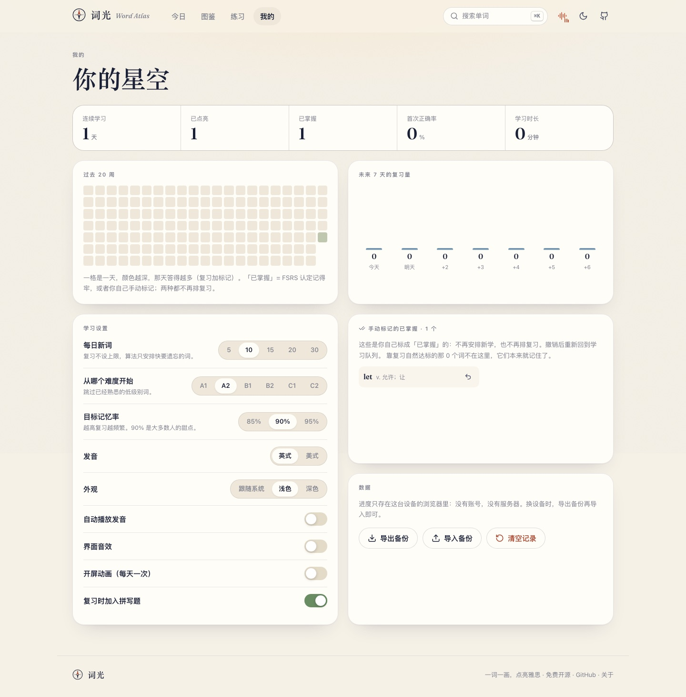

# 手动标记「已掌握」· 改动方案

> 需求：背单词时看到一个早就认识的词，手动标记一下，**以后别再反复考我**。
>
> 结论：复用原有的「已掌握」这一个状态，不新增概念。手动标记和 FSRS 自动达标**等价**——
> 两者都表示「学完了」，都不再排复习；区别只在于手动标记可以撤销。

## 1. 先回答两个疑问（事实核查）

**① 原版有没有这个功能？没有。**
`git grep markMastered/setMastered` 在原版代码里是空的，唯一能改变学习状态的入口是答题（FSRS）。

**② 能不能直接用原来的「已掌握」？能，但要先改它的语义。**

原版 `isMastered` 只用于徽章、筛选、统计和星图亮度，**调度完全不管它**：

```ts
// 原版 dueIds：只看 due 到没到
.filter(([, c]) => c.due <= now)
```

所以原版「已掌握」的词照样会回来考。用你的词库参数（90% 目标记忆率）实测了一个
稳定度刚过阈值（21 天）的卡片的复习节奏：

| 第 N 次复习（Good） | 下次间隔 |
| --- | --- |
| 1 | 55 天 |
| 2 | 131 天 |
| 3 | 289 天 |
| 4 | 593 天 |
| 5 | 1150 天（约 3 年） |

也就是说，原版里「已掌握」只是**抽查变稀**，不是停止。要让手动标记真的「不再反复背」，
必须同时改调度：**已掌握 ⇒ 不再排复习**。

## 2. 状态模型

用户可见只有三态，已掌握有两个来源：

```
             ┌── 复习答对，稳定度 ≥ 21 天 ──┐
未学 ──初见──▶ 学习中 ─────────────────────▶ 已掌握（不再复习）
  ▲              │                              │
  │              └──── 手动标记（K / 按钮）──────┘
  │                                             │
  └──────── 撤销（仅手动标记的，且没答过题）◀────┘
```

不要以为区分「手动/自动」只是文案问题——它决定了**撤销**能不能做：

| 来源 | 判定 | 能否撤销 | 撤销后去哪 |
| --- | --- | --- | --- |
| 复习达标 | `st === 2 && s >= 21`（`isAutoMastered`） | 不能（本来也没必要） | — |
| 手动标记 | `c.k === 1`（`isManual`） | 能 | 只标记过的 → 回到「未学」；答过题的 → 回到「学习中」，记忆保留 |

`src/store/srs.ts` 的单一出口：

```ts
export const isManual       = (c) => !!c && c.k === 1;                        // 手动
export const isAutoMastered = (c) => !!c && c.k !== 1 && c.st === 2 && c.s >= 21; // 自动
export const isMastered     = (c) => isManual(c) || isAutoMastered(c);        // 用户可见的「已掌握」
export const isLearning    = (c) => !!c && !isMastered(c);
export function wordState(c): "new" | "learning" | "mastered";
```

## 3. 调度语义的变化（这是这次改动的实质）

| 位置 | 改动前 | 改动后 |
| --- | --- | --- |
| `dueIds`（到期复习队列） | 所有 `due <= now` | 追加 `!isMastered(c)`：**已掌握不再进来** |
| `buildSession` 的指定 id（再练错词） | 排除手动标记 | 排除全部已掌握 |
| `advance` 顺带跳过 | 跳过手动标记的词 | 跳过全部已掌握的词 |
| 新词池 `nextNew` | 有卡就跳过 | 不变（已掌握的也有卡） |
| 「未来 7 天复习量」 | 统计所有卡 | 排除已掌握，避免虚高 |

**代价（明确写下来）**：靠 FSRS 真正达标的词也不再被抽查。它们本来一年最多考 1-2 次，
所以影响是「长期维护抽查」消失，换来的是列表不再打扰。如果以后想要回来，加一个
「已掌握的也按 FSRS 抽查」开关即可（见第 8 节），不需要动数据。

## 4. 交互入口

| 位置 | 交互 |
| --- | --- |
| 词条面板 | 「标记为已掌握」按钮；标好后变成「已掌握 · 点此撤销」；FSRS 自动达标的显示为不可点的「已掌握 · FSRS 判定」 |
| 词条面板 | 快捷键 <kbd>K</kbd>（自动达标的不响应，避免误以为能撤销） |
| 图鉴 · 列表视图 | 每行右侧圆点：空心=没学过，橙圈=学习中，绿勾=已掌握（自动达标的绿勾不可点） |
| 学习 · 初次见面 | 次要按钮「早就认识它」：标成已掌握，并把这个词本轮剩余步骤一起摘掉 |
| 我的 · 手动标记面板 | 最近 24 个手动标记，逐个撤销 |


<sub>学习页「初次见面」的「早就认识它」：标成已掌握，同时把这个词本轮剩下的步骤一起摘掉（上面的进度条会跟着重算）。</sub>

 

<sub>左：词条面板的标记按钮与 <kbd>K</kbd> 提示，标好后 chip 变「已掌握」；右：「我的」里的手动标记撤销列表。</sub>

## 5. 数据模型

在 `CardState` 上加了三个**可选**字段（旧数据不需要迁移，仍是备份格式 `version: 2`）：

| 字段 | 含义 |
| --- | --- |
| `k?: 1` | 手动标成已掌握 |
| `kAt?: number` | 标记时间（撤销列表排序用） |
| `kNew?: 1` | 这张卡只因标记而存在，用户没答过它 |

为什么放在卡片上而不是另开一张表：`cards` 已经是「这个词学过没有」的唯一答案；
另存一份必然出现「已掌握但不在 cards 里」的非法中间态，而且「已点亮」计数
（`Object.keys(cards).length`）会算错。

`kNew` 是撤销语义的关键：**没答过题**的词撤销时整张卡删掉（回到未学），
**答过题**的词撤销只摘掉标记、保留 FSRS 记忆与 `due`。

另外 `review()` 里显式保留 `k`：万一手动标记的词被再练一次，标记不会被静默抹掉，
同时清掉 `kNew`（它已经不算「只标记」了）。

## 6. 逐文件改动

| 文件 | 改动 |
| --- | --- |
| `src/store/srs.ts` | `CardState` 增 `k/kAt/kNew`；`wordState` 收敛为三态；新增 `isManual`/`isAutoMastered`；`isMastered` 改为两者并集；`review()` 保留标记；`markCardManual`/`clearCardManual`（只带标记的卡直接丢弃） |
| `src/store/store.ts` | `DayStat.k`（标记也算当天活动，不断签）；`validCard` 放行新字段；`sanitizeProgress` 兼容旧数据；新增 `setManual(id, on)` / `toggleManual(id)` |
| `src/store/session.ts` | `dueIds`/`buildSession`/`advance` 全部改用 `isMastered`；新增 `skipInSession(id)`；`masteredCount`（合并）、`manualMasteredCount`、`manualMasteredIds` |
| `src/pages/Atlas.tsx` | 保持 5 个筛选（全部/未学/学习中/已掌握/收藏）；列表行圆点变成可点的标记开关，自动达标的显示为不可点绿勾 |
| `src/pages/Today.tsx` | 统计仍是「已点亮 / 已掌握 / 全部词汇」；学习路线把已掌握算作完成 |
| `src/pages/Me.tsx` | 统计条回到 5 格（连续学习/已点亮/已掌握/首次正确率/学习时长）；新增「手动标记的已掌握」撤销面板；7 天复习量排除已掌握 |
| `src/ui/EntryView.tsx` | 标记按钮三态（未标/手动已掌握/自动已掌握）；<kbd>K</kbd> 快捷键；记忆说明随来源变化 |
| `src/pages/Learn.tsx` | 初次见面页「早就认识它」；`learn-stage` 的 key 带上 step id，摘步骤后不复用旧组件状态 |
| `src/galaxy/Galaxy.tsx` | 已掌握的星按点亮渲染，图例恢复「未学 / 学习中 / 已掌握」 |
| `src/styles/app.css` | `.mark-btn`（含 `.is-locked`）、`.mark-row`、`.mark-panel/.mark-list`、`.row-mark` 三态、`stat-strip` 回到 5 列 |
| `src/store/manual.test.ts` | 9 个用例：标记/撤销/两种已掌握/调度过滤/备份兼容/僵尸卡/日程计数 |

## 7. 边界情况

1. **只标记、没答过 → 撤销**：删卡，回到「未学」，不会留下「学习中」的僵尸卡。
2. **答过题再标记 → 撤销**：只摘标记，`reps/seen/s/d/due` 原样。
3. **标记后被再练一次**：`review()` 保留 `k`，标记不丢。
4. **自动达标的词**：界面同样显示「已掌握」，但没有撤销入口（按 <kbd>K</kbd> 也无效），不会出现「点了没反应」。
5. **会话进行中标记**：本轮剩余步骤整条摘掉，进度条重算；`advance` 也会跳过，防止跨标签页操作留下幽灵题。
6. **备份 / 旧数据**：`version: 2` 不变；旧备份缺 `k` 按 0 处理（有单测）。
7. **多标签页**：沿用 `storage` 事件同步，新字段走 `sanitizeProgress` 白名单。
8. **每日新词额度**：标记计入 `days.k`，不计入 `days.n`，不会挤掉今天该学的新词。

## 8. 验证

```bash
npm test        # 30 passed（新增 9 个用例）
npx tsc -b      # 类型通过
npm run build   # dist/ → NAS
```

浏览器端（Playwright，本地 + NAS 各跑一遍）：

| 检查 | 结果 |
| --- | --- |
| 未标记词条按钮 | 「标记为已掌握」 |
| 点击后 | 按钮「已掌握 · 点此撤销」，chip「已掌握」，说明「你手动标记的，不再安排复习」 |
| FSRS 达标词条 | 不可点标签「已掌握 · FSRS 判定」 |
| 图鉴状态筛选 | 5 个：全部/未学/学习中/已掌握/收藏；「已掌握」同时命中手动与自动两类 |
| 我的 | 已点亮 2 / 已掌握 2；面板「手动标记的已掌握 · 1 个」 |
| 控制台错误 | 0 |
| 已部署地址 | 自建静态站点（nginx 容器），发版来自同一份 `dist/` |

## 9. 没做 / 以后可选

- **「已掌握也继续抽查」开关**：如果你以后想要「一年验一次」，在「学习设置」加一个开关，
  打开后 `dueIds` 不清除 `isAutoMastered`（手动的仍然停），数据不用迁移。
- **批量标记**：目前逐词标（列表视图 + <kbd>K</kbd>）。要「整批认领」建议放在「我的」里并配二次确认。
- **跨设备同步**：进度仍是本机 localStorage（产品定位如此）。
